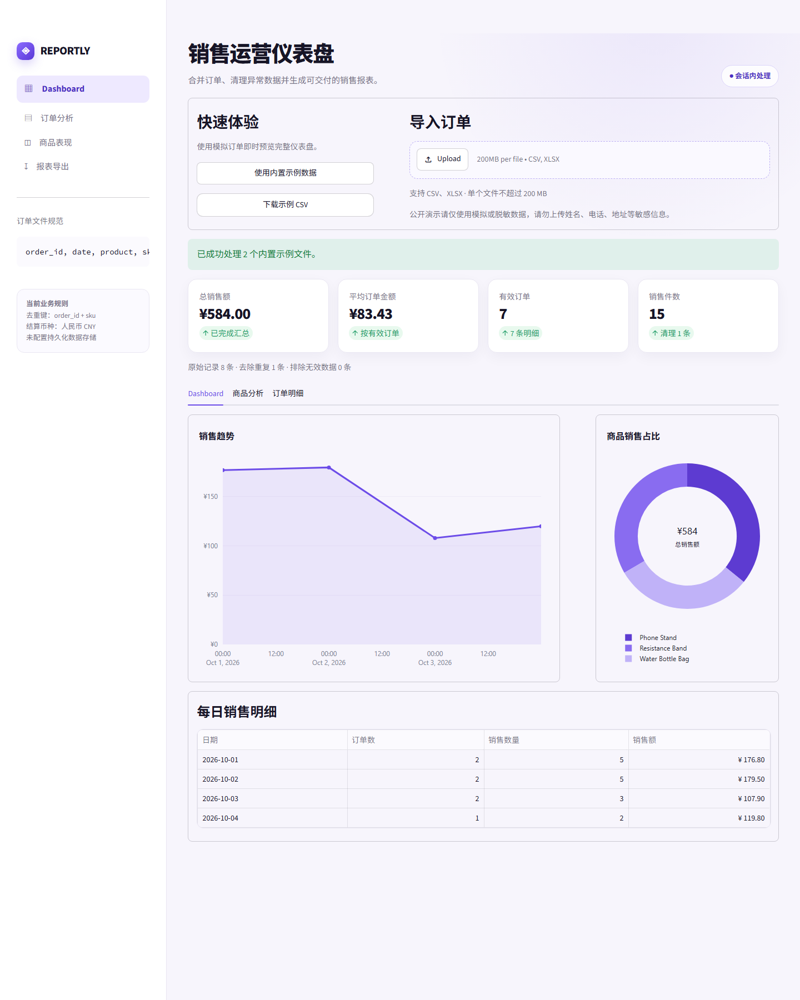

# E-commerce Report Automator

[中文](#中文说明) · [English](#english)

**在线演示 / Live demo：** [打开 REPORTLY 销售运营仪表盘](https://ecommerce-report-automator.streamlit.app)

一个面向中小型电商业务的订单清洗、销售分析和 Excel 报表自动化工具。上传多个 CSV/XLSX 文件后，应用会自动校验、合并、去重和汇总订单，并生成可下载的 Excel 报表。



> 当前版本：已发布的 MVP。仓库中的订单均为模拟数据，不包含真实客户信息。

## 中文说明

### 解决什么问题

电商运营经常需要手工合并多个订单表、删除重复记录、计算销售额并制作日报。本工具把这一固定流程整合为一个简单网页，减少重复操作，也可作为定制 Excel 自动化项目的基础。

### 主要功能

- 同时上传多个 CSV 或 XLSX 订单文件
- 自动识别常见中英文列名，并允许手动调整字段映射
- 清理无效日期、数量和价格
- 自定义去重字段组合，默认使用 `order_id + sku`
- 展示销售指标、每日趋势、商品排行、订单明细和数据质量报告
- 单独查看并下载重复或异常记录及其排除原因
- 中英文界面切换、自定义显示币种和报表文件名
- 导出 `Cleaned Orders`、`Daily Sales`、`Product Ranking`、`Rejected Rows` 四个工作表
- 对可能触发 Excel 公式的文本进行安全转义

### 快速开始

要求 Python 3.11。

```powershell
python -m venv .venv
.\.venv\Scripts\Activate.ps1
python -m pip install -r requirements.txt
python -m streamlit run app.py
```

打开 <http://localhost:8501>，点击“使用内置示例数据”，或上传 `sample_data` 中的两个样例文件，即可体验完整流程。

### 输入字段

| 字段 | 含义 | 示例 |
| --- | --- | --- |
| `order_id` | 订单编号 | `ORD001` |
| `date` | 下单日期 | `2026-10-01` |
| `product` | 商品名称 | `Phone Stand` |
| `sku` | 商品 SKU | `P001` |
| `quantity` | 销售数量 | `2` |
| `unit_price` | 商品单价 | `29.9` |

样例数据共有 8 条原始记录，去重后保留 7 条，总销售额为 `¥584.00`。

### 测试

```powershell
python -m pytest -v
```

测试覆盖 CSV/XLSX 读取、中英文列名识别、自定义字段映射、可配置去重、订单号前导零、空文件、缺失或重复字段、异常日期与数值、质量报告、Excel 内容一致性、双语界面和公式注入防护。

### 当前边界

- 币种选项只改变显示符号，不执行汇率换算
- 重复记录始终保留第一条，去重字段可在界面中调整
- 暂不处理退款、取消订单、税费、运费、库存和订单状态更新
- 不包含账号、数据库、ERP/API 对接或云端持久化
- 正式用于客户数据前，需要确认其唯一键和金额计算规则

### 数据安全

公开演示部署在 Streamlit Community Cloud。上传的文件会发送到托管服务进行处理；本项目未配置数据库或其他持久化数据存储。请勿向公开演示或公开仓库提交姓名、电话、地址、密钥等敏感信息，只使用模拟或充分脱敏的数据。

### 定制开发

本项目可以扩展字段映射、多平台订单格式、库存统计、定时报表和 API 集成。如需讨论具体需求，可通过 GitHub Issues 联系。

---

## English

### Live demo

[Open the REPORTLY sales dashboard](https://ecommerce-report-automator.streamlit.app)

### The problem

E-commerce teams often merge order files, remove duplicates, calculate sales, and build recurring reports by hand. This app turns that workflow into a small, reusable web tool and a practical starting point for custom Excel automation projects.

### Features

- Upload multiple CSV or XLSX order files
- Detect common Chinese and English headers and adjust field mappings manually
- Clean invalid dates, quantities, and prices
- Configure deduplication fields; the default is `order_id + sku`
- View KPIs, daily trends, product rankings, cleaned orders, and a data-quality report
- Review and download excluded rows with source files and rejection reasons
- Switch between Chinese and English, select a display currency, and customize the report name
- Export `Cleaned Orders`, `Daily Sales`, `Product Ranking`, and `Rejected Rows` worksheets
- Neutralize formula-like text before writing Excel files

### Quick start

Python 3.11 is recommended.

```powershell
python -m venv .venv
.\.venv\Scripts\Activate.ps1
python -m pip install -r requirements.txt
python -m streamlit run app.py
```

Open <http://localhost:8501> and click **使用内置示例数据**, or upload both files from `sample_data`.

### Expected sample result

The two sample files contain 8 rows. After deduplication, 7 rows remain and total sales equal `¥584.00`.

### Limitations

- Currency selection changes display symbols only; it does not convert values
- Deduplication fields are configurable; the first occurrence is retained
- Refunds, cancellations, shipping, tax, inventory, and status changes are not modeled
- No authentication, database, ERP/API integration, or cloud persistence
- Customer-specific identity and revenue rules must be confirmed before production use

### Data safety

The public demo runs on Streamlit Community Cloud. Uploaded files are sent to the hosted service for processing; this project does not configure a database or other persistent data store. Use synthetic or fully de-identified data only, and never upload names, phone numbers, addresses, credentials, or other sensitive information.

### Custom development

Possible extensions include column mapping, marketplace-specific formats, inventory summaries, scheduled reporting, and API integrations. Open a GitHub Issue to discuss a use case.

## Project structure

```text
EcommerceReportAutomator/
├── app.py
├── processor.py
├── sample_data/
├── tests/
├── assets/
├── docs/portfolio-zh-en.md
├── scripts/capture_portfolio.mjs
├── requirements.txt
└── README.md
```

## License

Released under the [MIT License](LICENSE).
