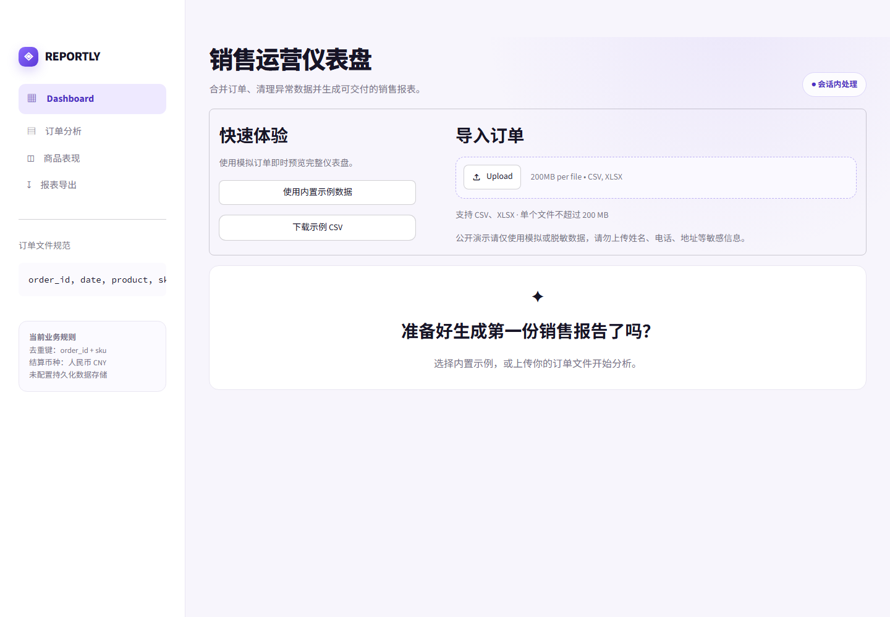
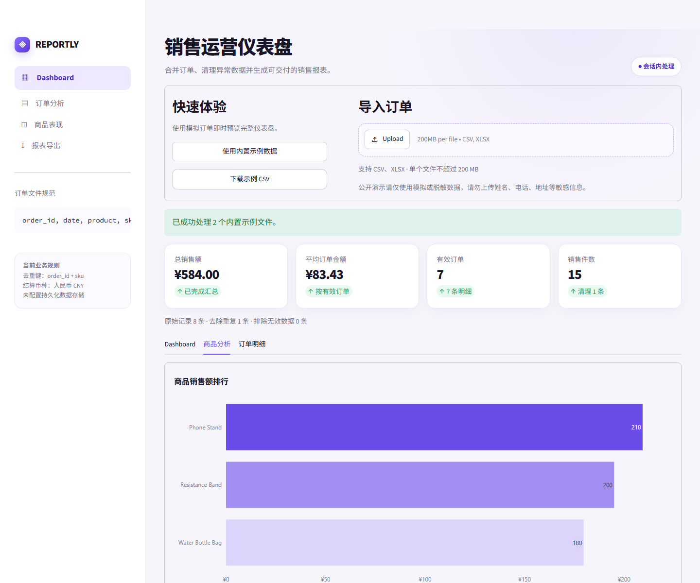
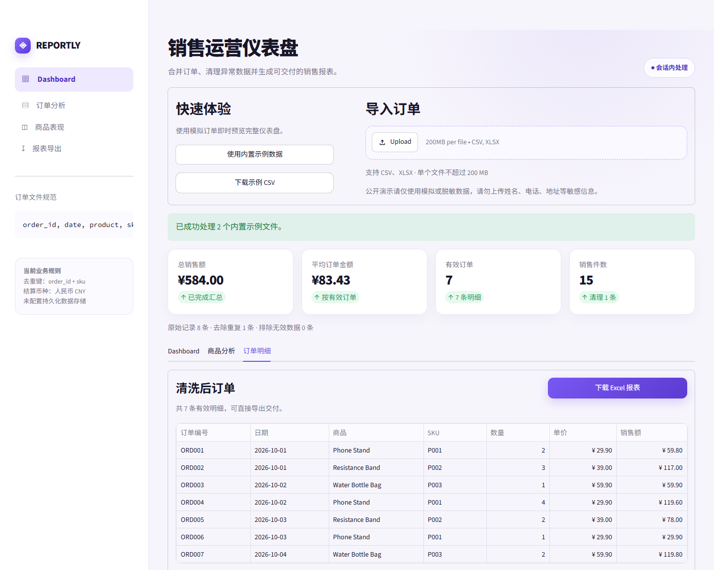

# REPORTLY 图文作品集 / Bilingual Portfolio Case Study

在线演示 / Live demo: <https://ecommerce-report-automator.streamlit.app>

源代码 / Source code: <https://github.com/samuelymt-hub/ecommerce-report-automator>

## 推荐发布顺序 / Recommended image order

1. 首页：说明输入方式与隐私边界。
2. 仪表盘：展示自动清洗后的核心经营指标。
3. 商品分析：展示商品销售额排行。
4. 订单明细：展示清洗结果和 Excel 交付入口。

## 1. 首页 / Upload experience

**中文配文：** 支持同时导入 CSV 与 XLSX 订单文件，也可以一键载入模拟数据。页面直接展示必要字段、去重规则和数据使用提醒，降低首次使用门槛。

**English caption:** Upload multiple CSV or XLSX order files, or load the built-in synthetic dataset for an instant walkthrough. Required fields, deduplication rules, and data-safety guidance are visible before processing begins.

## 2. 经营仪表盘 / Sales dashboard

**中文配文：** 系统自动合并订单、清理异常记录，并按 `order_id + sku` 去重。处理完成后集中展示总销售额、平均订单金额、有效订单、销售件数、每日趋势和商品销售占比。

**English caption:** The app merges files, removes invalid rows, and deduplicates line items by `order_id + sku`. It then presents total sales, average order value, valid orders, units sold, daily trends, and product share in one dashboard.

## 3. 商品分析 / Product analysis

**中文配文：** 商品分析页通过横向排行和汇总表快速识别高贡献商品，适合日常运营复盘、选品和销售结构分析。

**English caption:** The product view combines a ranked revenue chart with a summary table, making it easy to identify top contributors and review the sales mix.

## 4. 清洗明细与导出 / Cleaned orders and export

**中文配文：** 清洗后的订单明细可在页面核对，并一键导出为 Excel。生成文件包含 `Cleaned Orders`、`Daily Sales` 和 `Product Ranking` 三个工作表，可直接交付或继续分析。

**English caption:** Users can review cleaned line items in the browser and export a delivery-ready Excel workbook containing `Cleaned Orders`, `Daily Sales`, and `Product Ranking` worksheets.

---

## 中文项目介绍

### 一句话介绍

REPORTLY 是一个面向中小电商团队的订单清洗、销售分析和 Excel 报表自动化工具。

### 项目背景

电商运营经常需要重复完成“下载订单—合并表格—删除重复数据—计算销售指标—整理日报”这一流程。手工处理耗时，而且容易因为字段格式、重复订单或公式型文本导致结果不一致。

### 我的解决方案

我将这套流程封装为一个可直接使用的 Streamlit 网页应用：

- 支持批量上传 CSV/XLSX 文件；
- 自动规范化字段并校验必要列；
- 清理异常日期、数量和价格；
- 按 `order_id + sku` 去除重复明细；
- 生成经营 KPI、趋势图、商品排行和清洗明细；
- 导出包含三个工作表的 Excel 报表；
- 对公式型文本进行安全转义，降低 Excel 公式注入风险。

### 示例结果

两份模拟文件共包含 8 条原始记录。系统自动去除 1 条重复记录，保留 7 条有效订单明细，并计算出 `¥584.00` 的总销售额。整个过程无需手工复制、筛选或编写 Excel 公式。

### 技术与质量

- Python 3.11、Pandas、Streamlit、Plotly、OpenPyXL
- 15 项自动化测试覆盖文件读取、异常数据、去重、汇总、Excel 内容与公式注入防护
- 已部署在线演示，同时保留完整本地运行方式
- 项目未配置数据库或持久化存储；公开演示仅建议使用模拟或充分脱敏的数据

### 可定制方向

字段映射、多平台订单格式、退款与取消订单、库存统计、定时报表、邮件发送、ERP/API 对接和品牌化界面。

### 行动引导

如果你正在手工合并订单表、制作销售日报，或需要定制 Excel 自动化流程，可以通过 GitHub Issues 描述现有文件格式和期望输出。

## English project description

### One-line summary

REPORTLY is a lightweight order-cleaning, sales-analytics, and Excel-report automation tool for small e-commerce teams.

### The problem

Operations teams often repeat the same workflow: download order files, merge spreadsheets, remove duplicates, calculate sales metrics, and prepare recurring reports. Manual processing is slow and can produce inconsistent results when headers, dates, numeric values, or duplicate records vary between files.

### The solution

I turned that workflow into a deployable Streamlit application that:

- accepts multiple CSV and XLSX files;
- normalizes headers and validates required columns;
- removes rows with invalid dates, quantities, or prices;
- deduplicates line items by `order_id + sku`;
- produces KPIs, daily trends, product rankings, and cleaned details;
- exports a three-sheet Excel workbook;
- neutralizes formula-like text before writing spreadsheet cells.

### Sample outcome

The synthetic demo contains 8 input rows across two files. REPORTLY removes 1 duplicate, keeps 7 valid line items, and calculates `¥584.00` in total sales without manual copying, filtering, or spreadsheet formulas.

### Technology and quality

- Python 3.11, Pandas, Streamlit, Plotly, and OpenPyXL
- 15 automated tests covering file parsing, invalid data, deduplication, summaries, workbook output, and formula-injection protection
- Live cloud demo plus a documented local workflow
- No database or persistent storage is configured; the public demo should only be used with synthetic or fully de-identified data

### Customization options

Column mapping, marketplace-specific formats, refunds and cancellations, inventory summaries, scheduled reports, email delivery, ERP/API integrations, and branded interfaces.

### Call to action

If your team still merges order spreadsheets or builds recurring sales reports manually, open a GitHub Issue with a sample schema and the output you need.

---

## 国内平台发布短文案

最近完成了一个可在线体验的电商订单自动化报表工具 REPORTLY。

它可以批量读取 CSV/XLSX 订单文件，自动校验字段、清理异常数据、删除重复订单，并生成销售额、客单价、订单量、商品排行和每日趋势。清洗结果还能一键导出为包含 3 个工作表的 Excel 报表。

示例数据从 8 条原始记录中识别并删除 1 条重复记录，最终得到 7 条有效明细和 ¥584.00 总销售额。项目已完成 15 项自动化测试，并部署了在线演示。

适合需要订单合并、销售日报、Excel 自动化和定制数据看板的中小电商团队。公开演示请仅使用模拟或脱敏数据。

在线体验：<https://ecommerce-report-automator.streamlit.app>

源码：<https://github.com/samuelymt-hub/ecommerce-report-automator>

建议标签：`#Python` `#Streamlit` `#电商运营` `#Excel自动化` `#数据分析` `#副业项目`

## Short English post

I built REPORTLY, a deployable order-cleaning and sales-report automation tool for small e-commerce teams.

It accepts multiple CSV/XLSX files, validates the schema, removes invalid and duplicate rows, calculates sales KPIs, visualizes daily and product performance, and exports a three-sheet Excel workbook.

In the synthetic demo, REPORTLY processes 8 input rows, removes 1 duplicate, retains 7 valid line items, and calculates ¥584.00 in total sales. The project includes 15 automated tests and a live cloud deployment.

Useful for teams that still merge order exports or prepare recurring sales reports manually. Please use synthetic or fully de-identified data in the public demo.

Live demo: <https://ecommerce-report-automator.streamlit.app>

Source: <https://github.com/samuelymt-hub/ecommerce-report-automator>

Suggested tags: `#Python` `#Streamlit` `#Ecommerce` `#ExcelAutomation` `#DataAnalytics` `#PortfolioProject`
